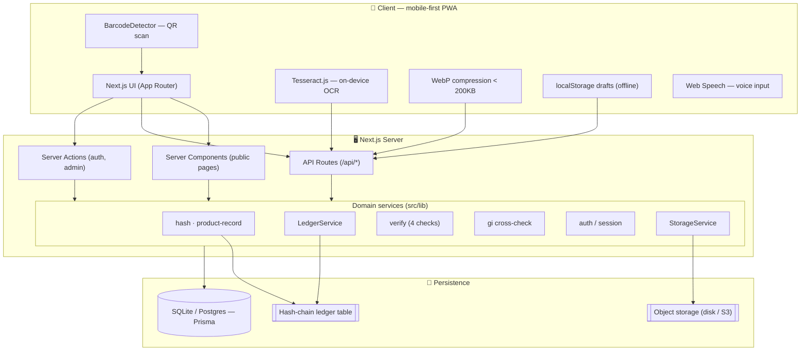
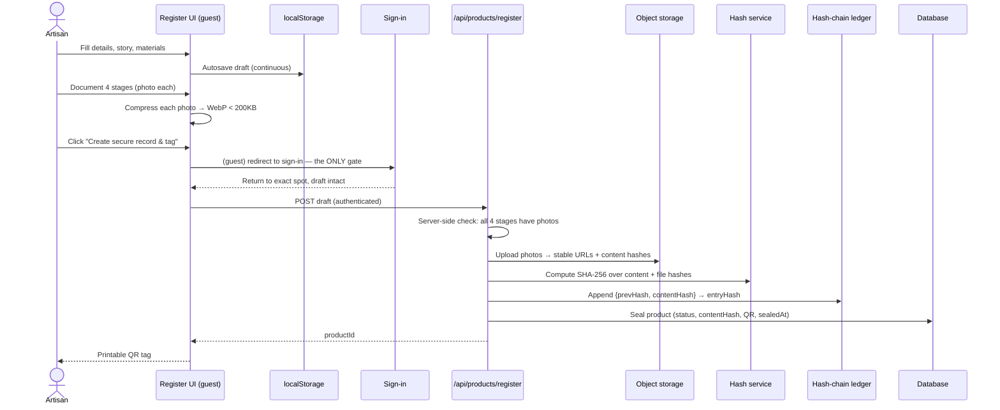
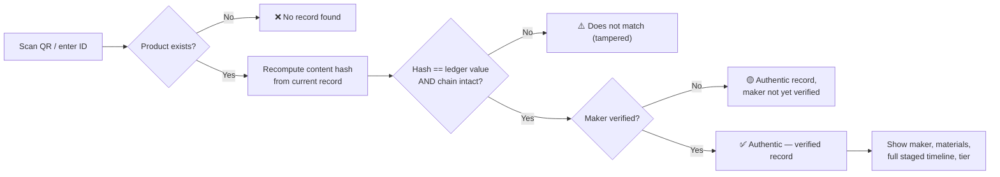
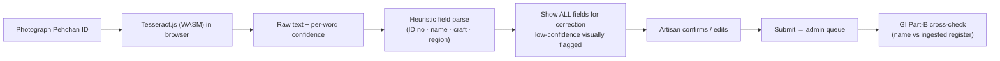

<div align="center">

# 🧵 Kaivanam — Artisan Craft Provenance Platform

**कैवन्नम · கைவண்ணம் · "the thread of art"**

*Linking every handcrafted item to a secure, tamper-evident record of the hand that made it.*

</div>

---

## 👥 Team Details

| Field | Detail |
|-------|--------|
| **Team name** | Hack Forge |
| **Event / Hackathon** | Rush Hour |
| **Track / Theme** | Decentralization |
| **Contact** | 9445426847 |

| Member | Role | GitHub / Contact |
|--------|------|------------------|
| Jeevan Sai V | Blockchain | 9445426847 |
| I Aditya Annamalai | Frontend Dev | 8861671352 |
| Harish Rahul P | UI designer | 9361279947 |
| Kaviya E | Backend Dev | 7092725215 |
| Jyoshitha D | Database | 9363256003 |
| Aakash B | Authentication | 9159005008 |

> _Replace the placeholders above with your actual team information before submission._

---

## 🎯 Problem Statement & Solution

### The problem
Authentic Indian handcrafted products — handloom sarees, Dokra metal art, terracotta
pottery — are being displaced by **mass-produced imitations** sold cheaper. A rural
artisan standing next to their work has **no reliable way to prove** it is genuine and
theirs. The result: falling artisan income, erosion of cultural heritage, and decline
of traditional craftsmanship.

### The solution
**Kaivannam** links a physical craft object to a **tamper-evident digital record** of
its origin and authenticity, using low-cost tags (QR now, NFC-ready later):

- Artisans document their work **photo-by-photo at each stage of creation** — not
  retrospectively — on a cheap Android phone, in their own language, even offline.
- Each item's record is sealed with a **SHA-256 content fingerprint** written to an
  **append-only ledger**, then issued a **printable QR tag**.
- **Any buyer** can scan the tag with **no account** and instantly see, in plain
  words, whether the item is authentic, who made it, and how it was made.
- A **public artisan register** lets buyers look up makers independently, with a
  **tiered verification** system that includes — rather than excludes — informal makers.

---

## ✨ Features

**Public & account-free**
- 🏠 Warm, craft-rooted landing page with re-themed splash animation
- 👥 Public **artisan register** — browse & search all makers by name / craft / state
- 👤 Individual artisan profiles with verification detail & documented items
- 🔍 **Product lookup** by ID or **live camera QR scan** (BarcodeDetector)
- ✅ **Consumer verification page** — 4 checks + full staged timeline in plain language

**Artisan-facing**
- 📝 Multi-step **product registration** with visible progress
- 📸 **Mandatory 4-stage timeline** (Raw Materials → Crafting → Finishing → Completed), photo required per stage
- 💾 **Autosaved drafts** — resume across days/devices; survives connection loss & the sign-in round-trip
- 🎙️ **Voice input on every text field** (Web Speech API, locale-aware)
- 🕵️ **Hidden signature** — private embedded mark, stored hashed, never shown publicly
- 🖨️ Printable **QR tag** on completion

**Verification system**
- 🪪 **Pehchan ID OCR** (on-device Tesseract.js) with correction UI + confidence flags
- 📜 **GI register cross-check** against a manually-ingested, versioned dataset
- 🏅 **5 tiered badges** (Self-declared → Docs pending → ID verified → GI authorised → Cooperative vouched)
- 🛠️ **Admin review queue** with side-by-side document / OCR / GI-match + audit log

**Accessibility & reach (built in, not polish)**
- ♿ WCAG 2.1 AA contrast, ≥16px text, 48×48px targets, full keyboard nav, semantic ARIA
- 🌐 **English / Hindi / Tamil** from day one; switcher in native scripts, no flags
- 📱 Mobile-first (360–400px), client-side **WebP compression <200KB**, offline-tolerant
- 🗓️ DD/MM/YYYY dates, ₹ Indian digit grouping, status never by colour alone

---

## 🧰 Complete Tech Stack

| Layer | Technology |
|-------|-----------|
| **Framework** | Next.js 15 (App Router, React 19, Server Components + Server Actions) |
| **Language** | TypeScript |
| **Styling** | Tailwind CSS 3 (custom craft design-system tokens) |
| **Fonts** | Noto Sans / Noto Sans Devanagari / Noto Sans Tamil (self-hosted via `next/font`) |
| **Database** | SQLite (dev) via **Prisma ORM** — swap `DATABASE_URL` → Postgres, no code change |
| **Object storage** | Abstraction layer (`StorageService`); local-disk driver in dev, S3/GCS-ready |
| **Ledger** | Append-only SHA-256 **hash chain** behind a swappable `LedgerService` interface |
| **Auth** | Session cookies (httpOnly) + **bcryptjs** password hashing |
| **OCR (on-device)** | **Tesseract.js** (WASM, offline, no API key) |
| **QR** | `qrcode` (server-generated PNG); `BarcodeDetector` API for scanning |
| **Crypto** | Node `crypto` (SHA-256), CSPRNG product IDs |
| **i18n** | Custom lightweight dictionary framework (JSON, English fallback) |
| **Tooling** | tsx, ESLint, Prisma CLI |

---

## 🏗️ System Architecture



**Key architectural principles**
- **DB holds no binaries** — only URLs, hashes, and metadata; files live in object storage.
- **Hash over content, not URLs** — the fingerprint survives a storage migration.
- **Server-side enforcement** of every rule that matters; client checks are UX only.
- **Swappable backends** — ledger and storage sit behind interfaces.

---

## 🔄 Detailed Workflow

### A. Artisan registers a product (auth triggered at exactly one point)



### B. Consumer verifies a product (no account)



### C. Identity verification (OCR + GI + admin)
1. Artisan photographs Pehchan ID → **Tesseract.js** extracts fields on-device.
2. Fields shown for **correction**; low-confidence flagged; artisan claims a GI cluster.
3. Submission → tier becomes **Documents pending**; request enters the admin queue.
4. Admin sees document + OCR + **GI Part-B cross-check** result → approves/rejects.
5. Approve → **ID verified**, upgraded to **GI authorised** if the name matches the register. Every decision is written to the **audit log**.

---

## 📁 Folder Structure

```
HackForge/
├── prisma/
│   ├── schema.prisma          # data model (11 models)
│   └── seed.ts                # demo data: 5 artisans, GI dataset, sealed product
├── public/samples/            # placeholder craft SVGs (demo only)
├── scripts/make-samples.mjs   # generates the sample images
├── src/
│   ├── app/
│   │   ├── layout.tsx         # root: fonts, i18n provider, header/footer, splash
│   │   ├── page.tsx           # landing
│   │   ├── artisans/          # register (directory) + [id] profile
│   │   ├── lookup/            # product lookup + QR scan
│   │   ├── product/[id]/      # consumer verify page + /tag (printable)
│   │   ├── register/          # multi-step product registration (auth gate at seal)
│   │   ├── login/             # single auth touchpoint + server actions
│   │   ├── my-items/          # drafts (device) + published items
│   │   ├── verify-identity/   # Pehchan OCR flow
│   │   ├── admin/             # review queue + GI ingest + actions
│   │   └── api/
│   │       ├── files/[...key] # serve uploaded files
│   │       ├── products/[id]/qr        # QR PNG
│   │       ├── products/register       # seal a product (hash+ledger+QR)
│   │       └── verify-identity         # submit ID verification
│   ├── components/
│   │   ├── views/             # page-level views (i18n-aware)
│   │   ├── form/              # fields, voice, photo capture, progress steps
│   │   ├── icons.tsx          # inline SVG icon set
│   │   ├── TierBadge.tsx      # verification tier badge + explanation
│   │   └── SiteHeader/Footer, LanguageSwitcher, Splash, ui.tsx
│   └── lib/
│       ├── db.ts hash.ts ids.ts ledger.ts storage.ts qr.ts
│       ├── auth.ts verify.ts gi.ts product-record.ts format.ts
│       ├── i18n/             # config, dictionaries (en/hi/ta), provider, server
│       └── client/          # image compression, drafts, (voice)
├── animation.css              # original provided asset (reference)
├── template1.png template2.png landingpage.png   # design references
└── README.md
```

---

## 🚀 Installation & Usage

### Prerequisites
- Node.js ≥ 18 (developed on v25), npm

### Setup
```bash
npm install
npm run db:reset      # push schema to SQLite + seed demo data
npm run dev           # http://localhost:3000
```

Production build:
```bash
npm run build
npm run start
```

### Handy scripts
| Script | Purpose |
|--------|---------|
| `npm run dev` | Dev server |
| `npm run build` | Prisma generate + production build |
| `npm run db:push` | Sync schema to DB |
| `npm run db:seed` | Seed demo data |
| `npm run db:reset` | Wipe + re-seed (clean demo state) |

### Demo logins
| Role | Handle | Password |
|------|--------|----------|
| Artisan | `9840012345` | `password` |
| Admin | `admin` | `admin123` |

### Try it in 60 seconds
1. **Verify** — Check a product → `KS-4F7Q-9XB2-M3KP` → *Authentic*, full timeline.
2. **Register** — Register a product → fill as guest → sign in only at "Create record" → get QR tag.
3. **Admin** — sign in as admin → review the pending verification / ingest a GI dataset.
4. **Language** — top-right globe → हिन्दी / தமிழ்.

### Environment (`.env`, git-ignored)
```
DATABASE_URL="file:./dev.db"     # swap for a Postgres URL in production
SESSION_SECRET="<long-random>"
LEDGER_BACKEND="local"            # swappable ledger backend
STORAGE_DRIVER="local"           # swappable object storage
```

---

## 🗄️ API & Database Documentation

### HTTP API routes
| Method | Route | Auth | Purpose |
|--------|-------|------|---------|
| `POST` | `/api/products/register` | ✅ session | Validate 4 stages, upload photos, compute hash, append ledger, issue QR |
| `GET` | `/api/products/[id]/qr` | public | PNG QR encoding the public verify URL |
| `GET` | `/api/files/[...key]` | public | Serve an uploaded file from object storage |
| `POST` | `/api/verify-identity` | ✅ session | Store ID image + OCR fields, create verification request |

### Server Actions (form-invoked)
| Action | Location | Purpose |
|--------|----------|---------|
| `signInAction` / `signUpAction` / `signOutAction` | `app/login/actions.ts` | Auth (bcrypt + session cookie), safe `next` redirect |
| `decideVerification` | `app/admin/actions.ts` | Approve/reject → tier update + GI upgrade + audit log |
| `ingestGiDataset` | `app/admin/actions.ts` | Ingest a new versioned GI dataset |

### Database models (Prisma / `prisma/schema.prisma`)
| Model | Purpose |
|-------|---------|
| `User`, `Session` | Accounts (only for registering) + sessions |
| `Artisan` | Public profile, **verification tier**, hashed **hidden signature** |
| `Product` | Item record: title, materials, story, status, `contentHash`, QR |
| `StageEntry` | Append-only staged timeline (photos, server timestamp, version) |
| `LedgerEntry` | Hash-chain: `seq`, `prevHash`, `contentHash`, `entryHash`, `isTestnet` |
| `VerificationRequest` | Pehchan OCR fields + confidence, claimed GI, review status |
| `GiDataset`, `GiEntry`, `GiMatch` | Versioned GI register + Part-B cross-check results |
| `AuditLog` | Every admin decision (actor, action, target, detail) |

**Data hygiene:** image binaries are **never** stored in the database — only URLs +
content hashes + metadata.

---

## 🤖 AI/ML Workflow (OCR)

kaivannam uses **on-device OCR** — chosen deliberately for the rural context: it works
**offline**, needs **no API key**, and **no personal ID data leaves the phone**.



- **Model:** Tesseract OCR (English trained data) via `tesseract.js`, lazy-loaded so it
  never bloats the initial bundle.
- **Never silently trusted:** extracted values are always surfaced for human correction;
  fields below a confidence threshold are flagged for manual re-entry.
- **Provenance always shown** on GI checks: *"Cross-checked against GI Registry data as
  of DD/MM/YYYY"* — never implies a live government API.
- **Roadmap:** language-specific traineddata (Hindi/Tamil), and an optional
  image-similarity model to compare a disputed item against its recorded stage photos.

---

## 🔌 Hardware Components, Circuit / Wiring Diagrams

**Not applicable** — kaivannam is a software platform. The only physical component is the
**low-cost printed QR tag** attached to each item (NFC-ready as a future upgrade). No
microcontrollers, sensors, or wiring are involved; it runs on the artisan's existing
Android phone.

---

## 🔐 Security Measures

- **Tamper-evident ledger** — append-only SHA-256 hash chain; each entry embeds the
  previous entry's hash, so altering any past record breaks every later link.
- **Content-addressed hashing** — the fingerprint is computed over content + file
  content hashes (not mutable URLs), so it can't be silently invalidated by migration.
- **Server-side enforcement** — stage completion, auth, and file handling are validated
  on the server; client checks are UX only.
- **Non-guessable IDs** — product IDs use a CSPRNG (80+ bits), not sequential counters.
- **Password security** — bcrypt-hashed passwords; **httpOnly**, `sameSite=lax`,
  `secure`-in-prod session cookies.
- **Hidden signature protection** — stored **hashed**, access-restricted, and **never**
  rendered on any public page (verified in tests).
- **Open-redirect safe** — post-login `next` is validated to internal paths only.
- **Least data** — object storage holds files; the DB holds no binaries; OCR runs
  on-device so ID images need never leave the phone for extraction.
- **Honest labelling** — the dev/test ledger is clearly marked in the UI; it never
  implies a permanent public record where none exists yet.

---

## 🧪 Testing & Performance

### Verified end-to-end (smoke tests against a running build)
| Test | Result |
|------|--------|
| All public routes | `200`; `/admin` & `/verify-identity` correctly `307` → login |
| **Tamper detection** | Editing a sealed record in the DB flips verdict to *"does not match"*; restoring flips back to *Authentic* |
| **Full authenticated seal** | New product created: photos uploaded → hash → **ledger seq grew** → QR issued → verifies *Authentic* |
| **Auth gate** | `register` API returns `401` without a session; browsing never blocked |
| **Hidden signature** | Hash & private hint absent from all public HTML |
| **GI cross-check** | Genuine name → GI match; imposter name → no match |
| **i18n** | Hindi & Tamil cookies render Devanagari / Tamil on server pages |
| **QR endpoint** | Returns valid `image/png` |

### Performance
- Production build passes types + lint; **~120 kB first-load JS**; Tesseract.js lazy-loaded.
- Client-side image compression targets **<200KB/photo**; self-hosted fonts; mobile-first.
- Designed and testable against **throttled 3G** on a 360–400px viewport.

_Run the app and repeat: `npm run build && npm run start`, then exercise the demo path._

---

## 🧗 Challenges Faced & Future Scope

### Challenges
- **Provenance that survives storage migration** — solved by hashing content + file
  content hashes rather than URLs, via a shared record-builder used by seed, seal, and verify.
- **Auth at exactly one point** — keeping the whole registration usable as a guest and
  preserving state across the sign-in round-trip (localStorage drafts + `next` return).
- **Verification without excluding informal makers** — designed a 5-tier system with
  plain-language meaning instead of a binary verified/unverified gate.
- **No live GI API** — built an honest, versioned, date-stamped manual ingest + cross-check.
- **Accessibility as a constraint** — WCAG-AA contrast on a vibrant craft palette,
  icon+text status everywhere, voice on every field.

### Future scope
- 📡 **NFC tags** alongside QR; service-worker **background-sync** for true offline upload queueing.
- 🧾 Pluggable **production ledger** (Hyperledger Fabric / L2) behind the existing interface.
- 🗣️ More languages + Hindi/Tamil OCR traineddata; TTS read-aloud for low-literacy users.
- 🖼️ **Image-similarity** dispute resolution against recorded stage photos.
- 🤝 Cooperative-vouching workflow UI; artisan payouts / marketplace integration.
- 📊 Buyer-facing provenance analytics and cluster dashboards.

---

## 🎬 Demo — Screenshots / Video

> _Add your captures/links before submission._

- 🎥 **Demo video:** _`<link>`_
- 🖼️ **Screenshots:** _`<add to /docs and link here>`_
  - Landing · Artisan register · Product verification (Authentic + timeline)
  - Multi-step registration · QR tag · Pehchan OCR · Admin queue · Language switch

_Local demo entry points:_ `/` · `/artisans` · `/product/KS-4F7Q-9XB2-M3KP` ·
`/product/KS-4F7Q-9XB2-M3KP/tag` · `/register` · `/admin`

---

## 📚 References

- Next.js — https://nextjs.org/docs
- Prisma ORM — https://www.prisma.io/docs
- Tailwind CSS — https://tailwindcss.com/docs
- Tesseract.js (OCR) — https://github.com/naptha/tesseract.js
- `qrcode` — https://github.com/soldair/node-qrcode
- Web Speech API (voice input) — https://developer.mozilla.org/docs/Web/API/Web_Speech_API
- BarcodeDetector API (QR scan) — https://developer.mozilla.org/docs/Web/API/BarcodeDetector
- WCAG 2.1 — https://www.w3.org/TR/WCAG21/
- Geographical Indications Registry, India — https://ipindia.gov.in/gi.htm
- Noto Sans fonts — https://fonts.google.com/noto

---

<div align="center">

_This is a demonstration build. Records shown are on a clearly-labelled test system._

**Kaivannam— proof of the hand that made it.**

</div>
